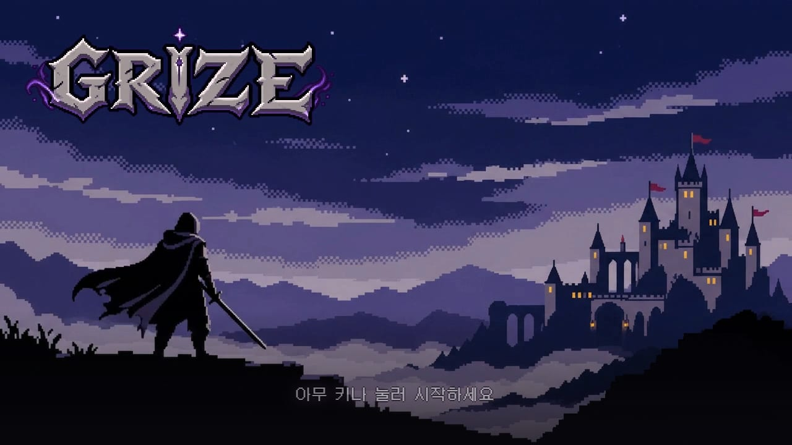
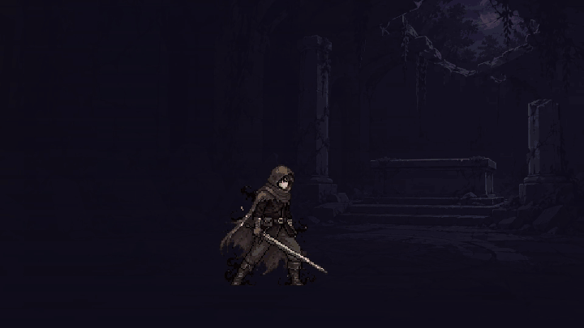
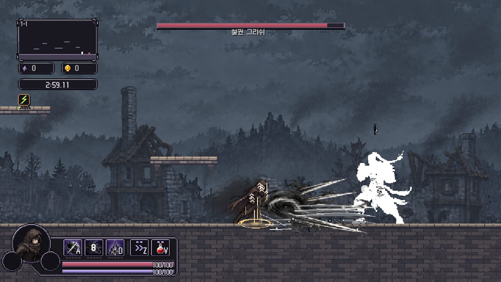
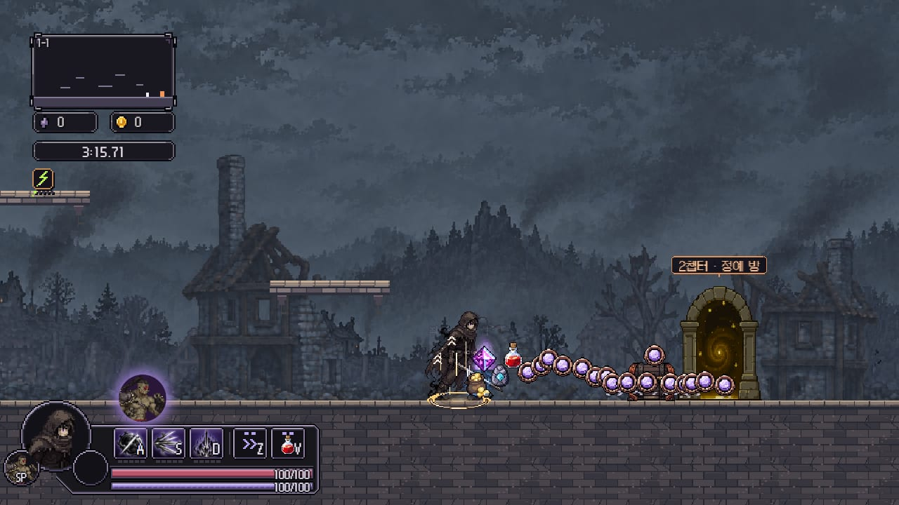
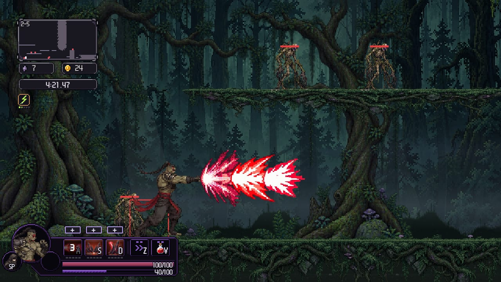
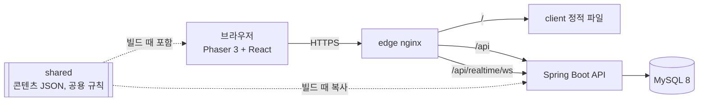

# Grize

브라우저에서 바로 하는 횡스크롤 액션 로그라이트

[플레이 (itch.io)](https://jkhm.itch.io/grize) · [웹 페이지](https://stackout-k1m.github.io/Grize/) · [게임 소개](docs/game/concept.md) · [기술 구조](docs/tech/architecture.md) · [담당 업무](docs/my-role.md) · [English summary](#english-summary)

<!-- TODO: 대표 영상 (YouTube 일부 공개) 썸네일 링크 -->

| | |
|---|---|
| 개발 기간 | 2026.10.11 ~ 11.20 |
| 서비스 기간 | 2026.10.30 ~ 11.27 |
| 팀 | 7명 (SSAFY 15기 자율 프로젝트) |
| 맡은 일 | 인프라, 백엔드, 에셋 일부 |
| 사용 기술 | Phaser 3, React, TypeScript, Spring Boot 3, MySQL 8, WebSocket, Docker, nginx, Jenkins, Prometheus, Grafana |

> 운영 서버(www.grize.site)는 11월 27일에 내려갑니다. itch.io 에 올린 판은 서버를 빼고 다시 묶은 싱글 판이라 그 뒤에도 실행됩니다. 진행 기록은 브라우저에 저장되므로 기기를 바꾸면 처음부터 시작합니다.

## 게임 소개

보스를 쓰러뜨리면 그 보스의 그림자를 흡수하고, 이후에는 그 보스로 변신(의태)해 같은 기술을 쓸 수 있습니다. 「강한 적의 기술을 직접 써 보고 싶다」는 생각에서 출발한 규칙이고, 세계관도 이 규칙에 맞춰 만들었습니다.

| 보스전 | 그림자 흡수 | 의태한 뒤 보스 기술 사용 |
|:---:|:---:|:---:|
|  |  |  |

원정은 광장에서 출발해 방을 하나씩 지나며 보스를 잡는 구조입니다. 3챕터까지 공개했고 보스 16명, 유물 140개(시너지 10종)가 있습니다. 원정 중에 쓰러지면 골드와 유물은 잃지만, 흡수한 그림자와 영구 재화는 남아 다음 원정을 조금 더 강하게 시작합니다.

운영하면서 족쇄의 원정, 인내의 탑, 심연의 탑, PvP, 그몽어스, 생존 모드, 라인 전쟁을 차례로 추가했습니다.

더 보기: [컨셉과 세계관](docs/game/concept.md), [콘텐츠](docs/game/contents.md)

## 운영 결과

10월 30일에 서비스를 열고 11월 22일 18시 5분(KST)에 집계한 값입니다.

| 누적 플레이 시간 | 계정 | 원정 플레이 | 피드백 반영 |
|:---:|:---:|:---:|:---:|
| 225시간 8분 (약 9일 9시간) | 215개 | 1,401회 | 49건 중 36건 |

처음 열었을 때 콘텐츠는 원정 하나였습니다. 「원정 말고 할 게 없냐」는 의견이 이어져서, 원정에 쓴 보스와 맵을 다른 모드에서 다시 쓰는 방식으로 콘텐츠를 늘렸고 운영 기간 동안 15번 업데이트했습니다.

더 보기: [운영과 피드백](docs/game/operation.md)

## 기술 구성

- 보스 능력치나 유물 효과 같은 콘텐츠 데이터는 JSON 한 벌을 클라이언트와 서버가 함께 읽습니다. 양쪽 판이 어긋나면 해시 비교로 원정 시작 단계에서 막힙니다.
- 원정은 혼자 하는 모드지만 랭킹과 영구 재화가 걸려 있습니다. 그래서 방 구성과 보상 계획은 서버만 갖고 있고, 클라이언트가 보낸 결과를 그 계획과 대조합니다.
- 서버 한 대에 운영 환경과 개발 환경을 따로 띄웠습니다. develop 브랜치에 병합하면 개발 서버로 자동 배포되고, 운영 배포는 사람이 직접 실행합니다.

더 보기: [기술 구조](docs/tech/architecture.md), [서버 권위 원정과 보안](docs/tech/server-authority.md), [실시간 동기화](docs/tech/realtime.md), [인프라와 배포](docs/tech/infra.md)

## 팀이 해결한 문제

| 문제 | 대응 | 결과 |
|---|---|---|
| 입장할 때마다 로딩이 길었음 | 그림을 무손실 WebP 로 바꾸고 그림 묶음을 나눔 | 챕터 입장 25초 → 8초, 광장 6초 → 2초 |
| API 만 호출해 싸우지 않고 랭킹 1위가 가능했음 | 서버 시계와 처치 목록 대조, 허니팟 몹, 이상 기록 탐지 | 위조 클리어는 무효 처리, 남은 의심 기록은 GM 이 판정 |
| PvP 에서 상대가 늦게 보였음 | 전송 빈도와 보간 지연 조정 | 상대 표시 지연 약 250ms → 115ms |

더 보기: [트러블슈팅](docs/tech/troubleshooting.md), [예상 질문과 답](docs/tech/qna.md)

## 담당 업무

- DB 스키마와 ERD, API 공통 규약과 원정 API 명세를 작성했습니다.
- 이메일·Google 로그인과 JWT 인증, Flyway 스키마, 서버 쪽 원정 저장(체크포인트, 정산)을 처음 구현했습니다.
- 클라이언트의 원정 진행을 서버 저장에 연결했습니다 (상점, 유물, 의태 획득, 갈림길, 특성 강화).
- 서버 구축과 운영을 맡았습니다. Docker Compose 설정, nginx와 HTTPS, 도메인, Jenkins 자동 배포, 운영·개발 환경 분리, DB 백업을 했습니다.
- 3챕터 보스 카이론의 그림과 기술 이펙트, itch 판의 새 광장 배경과 NPC를 만들었습니다.
- 최종 발표 자료를 만들고 발표했습니다.

더 보기: [담당 업무 상세](docs/my-role.md), [에셋 제작](docs/game/art-pipeline.md)

## 팀

| 이름 | 역할 |
|---|---|
| 김재원 (본인) | 인프라, 백엔드 |
| 이XX | UI, 클라이언트 |
| 박XX | 클라이언트 |
| 송XX | 클라이언트 |
| 문XX | 클라이언트 |
| 장XX | 에셋 |
| 조XX | 에셋 |

이 저장소에는 게임을 소개하는 문서와 그림, 영상만 있고 게임 소스 코드는 없습니다. 그림과 영상의 저작권은 팀에 있습니다.

같은 내용을 웹 페이지로도 정리했습니다: [소개](https://stackout-k1m.github.io/Grize/), [게임](https://stackout-k1m.github.io/Grize/game.html), [기술](https://stackout-k1m.github.io/Grize/tech.html).

---

## English summary

**Grize** is a side-scrolling action roguelite that runs in the browser. When you defeat a boss you absorb its shadow, and from then on you can transform into that boss ("mimicry") and use its skills.

- **Team project** (7 people, SSAFY, Oct–Nov 2026). The live service ran from Oct 30 to Nov 27, 2026. As of Nov 22: 215 accounts, 1,401 expeditions played, 225 hours of total play time; 36 of 49 player requests shipped across 15 updates.
- **My part: infrastructure and backend, plus some assets.** Database design and API specs, email / Google sign-in with JWT, the first version of server-side expedition saving (checkpoints and settlement), wiring the client's expedition flow to the server, and the whole deployment: Docker Compose, nginx with TLS, Jenkins CI/CD, separate production and development stacks on one server, daily DB backups. I also made the chapter-3 boss Kairon (sprite and skill effects) and the new plaza background and NPCs for the itch.io build.
- **Stack**: Phaser 3 + React (TypeScript) on the client; Spring Boot 3 + MySQL 8 with WebSocket rooms on the server; one shared content package (JSON validated with Zod) read by both.
- **Notable parts**: the server keeps each run's plan and checks reported results against it (idempotent writes with revision checks); honeypot monsters and k-NN anomaly scores against forged clears; lossless WebP and split asset packs cut chapter loading from 25 s to 8 s.
- **Play** the single-player build on [itch.io](https://jkhm.itch.io/grize). It needs no server.
