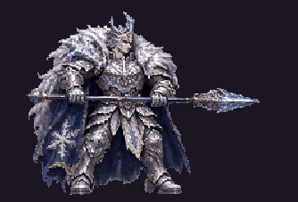
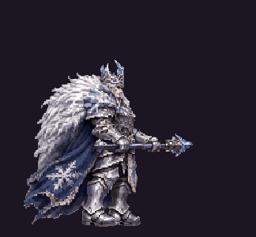
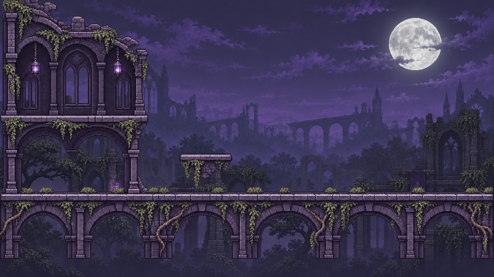
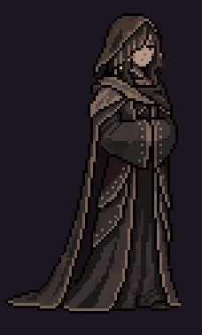
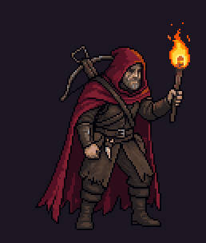
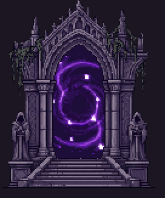
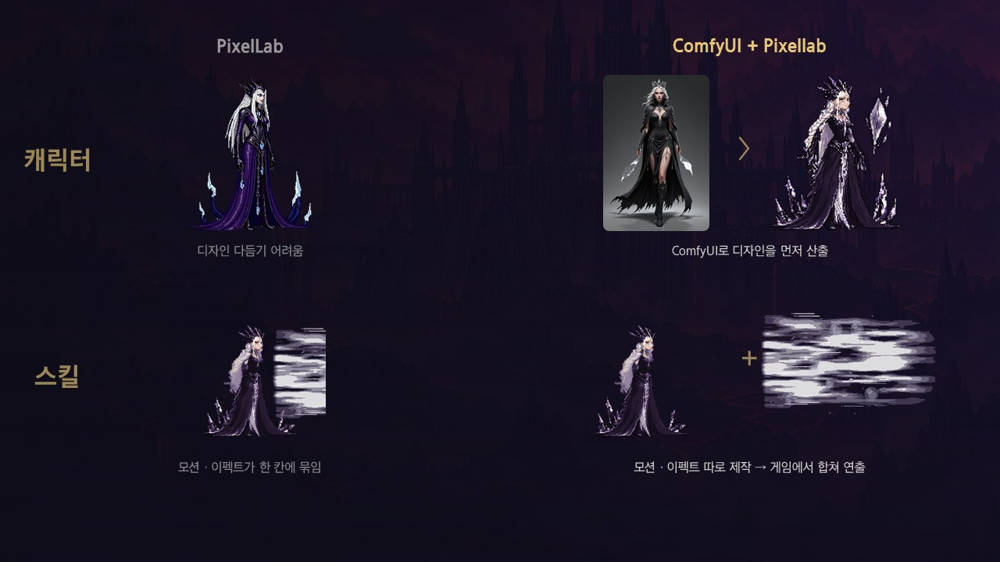
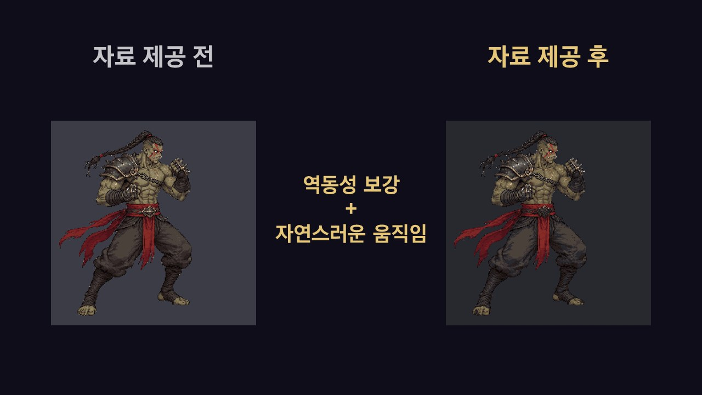

# 에셋 제작

[← README](../../README.md) · [컨셉과 세계관](concept.md) · [콘텐츠](contents.md) · [운영과 피드백](operation.md)

게임 그림은 대부분 이미지 생성 도구로 원화를 만든 뒤 도트 그림과 동작 프레임으로 바꿔서 썼습니다. 에셋은 에셋 담당 팀원이 주로 만들었고, 그중 보스 1종과 itch 판 광장, NPC 일부는 직접 제작했습니다.

## 직접 제작한 에셋

### 3챕터 보스 카이론

| 공격 | 창 회전 |
|:---:|:---:|
|  |  |

얼음 산맥 챕터의 중간 보스입니다. 원화를 정한 뒤 PixelLab 으로 동작 프레임(돌진, 도약 후 내려찍기, 창 던지고 회수, 회전, 걷기)을 만들고, 기술 이펙트 10여 종(얼음 창, 서리 파문, 회전하는 얼음 고리 등)을 따로 만들어 게임에 붙였습니다. 패턴과 밸런스, 플레이어가 카이론으로 의태했을 때 쓰는 기술 연결까지 담당했습니다.

### itch 판 광장

싱글 판은 다른 플레이어가 없는 광장이라, 시설을 줄이고 배경을 새로 만들었습니다. 원경(하늘, 달, 먼 수도교), 근경(폐허 아치, 나무), 플레이 층(다리, 2층 건물) 세 장으로 나눠 카메라가 움직일 때 층마다 다른 속도로 흐르게 했습니다. 원화는 이미지 생성 도구로 만들고 게임 화면 크기와 도트 크기에 맞게 다듬었습니다.

### NPC 와 포탈

| 광장 사제 | 떼사냥꾼 (생존 모드) | 원정 포탈 |
|:---:|:---:|:---:|
|  |  |  |

- 광장 사제: itch 판 광장에서 성장 기능을 안내하는 NPC 입니다. 대화 화면의 상반신 그림을 먼저 정하고, 그 모습에 맞춰 PixelLab 으로 서 있는 모습과 숨쉬는 동작을 만들었습니다.
- 떼사냥꾼: 광장에서 생존 모드로 들어가는 NPC 입니다.
- 원정 포탈: 광장에서 원정을 시작하는 문입니다.

## 팀의 캐릭터 제작 방식

> 에셋 담당 팀원(장XX, 문XX)의 작업을 정리한 내용입니다.

처음에는 PixelLab 만으로 캐릭터를 만들었는데, 디자인을 원하는 방향으로 다듬기 어렵고 동작과 이펙트가 한 그림에 붙어 나와 따로 쓸 수 없었습니다. 그래서 ComfyUI(SDXL)로 캐릭터와 이펙트의 원화를 따로 만든 다음, PixelLab 으로 256px 도트 그림과 동작 프레임을 뽑고, 이펙트는 게임 안에서 합치는 순서로 바꿨습니다.

동작을 만들 때는 「훅을 날리는 모습」처럼 짧게 지시하면 팔만 뻗는 어색한 동작이 나오거나, 중간 프레임에서 팔꿈치가 꺾이고 팔이 사라지는 오류가 생겼습니다. 팀원은 근육과 관절 이름을 정확히 적고, 동작 사진과 직접 그린 막대 인형으로 순서를 지정해서 이 문제를 줄였습니다.

