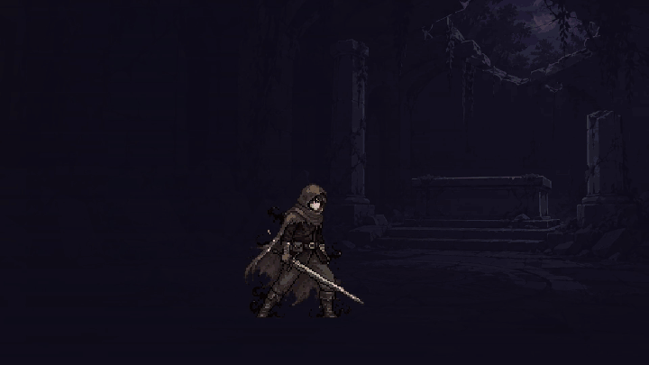
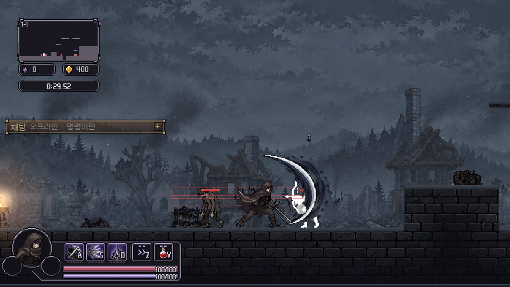
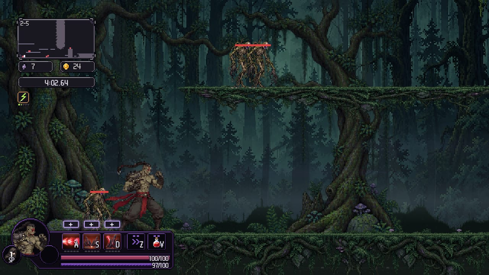
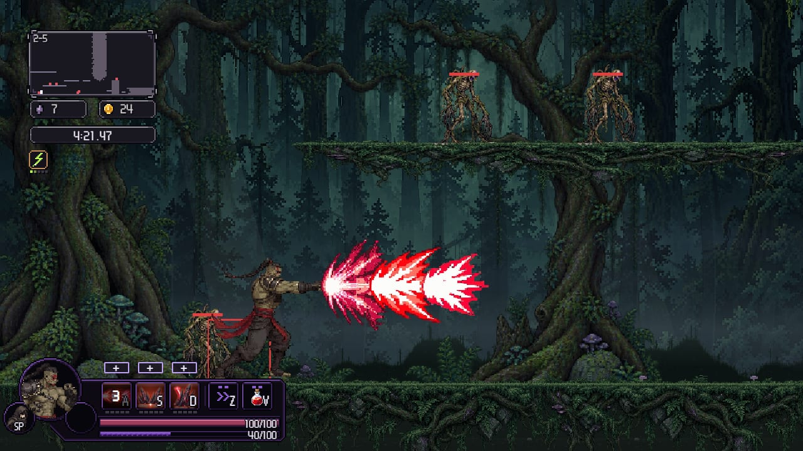
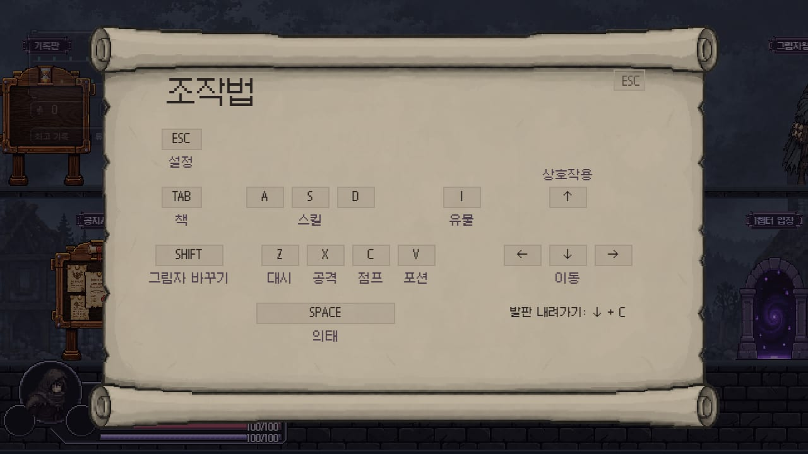

# 컨셉과 세계관

[← README](../../README.md) · [콘텐츠](contents.md) · [운영과 피드백](operation.md) · [에셋 제작](art-pipeline.md)

## 기획 의도

액션 게임에서 강한 보스를 만나면 그 보스의 기술을 직접 써 보고 싶어집니다. Grize 는 이 바람을 규칙으로 만든 게임입니다. 보스를 쓰러뜨리면 그 보스의 그림자를 흡수하고, 이후에는 그 보스로 변신해 같은 기술을 쓸 수 있습니다. 게임 안에서는 이 변신을 「의태」라고 부릅니다.

설치 없이 주소만 열면 플레이할 수 있게 브라우저 게임으로 만들었습니다. 첫 사용자는 같은 캠퍼스의 교육생과 코치였습니다.

## 세계관과 규칙

주인공은 마족의 습격으로 고향을 잃은 변방 마을의 소년입니다. 잊힌 「그림자의 신」과 계약해 자기 그림자를 내주고, 그 대가로 쓰러뜨린 상대의 그림자를 거두는 힘을 얻습니다.

세계관을 먼저 정한 뒤, 게임 규칙이 그 설정과 어긋나지 않게 맞췄습니다.

| 세계관 설정 | 게임 규칙 |
|---|---|
| 쓰러져 주인을 잃은 그림자만 거둘 수 있다 | 보스를 처치해야 흡수할 수 있음 |
| 그림자는 주인의 동작을 기억한다 | 의태하면 그 보스의 모습과 기술을 그대로 씀 |
| 한 번에 깨워 둘 수 있는 그림자는 많지 않다 | 원정에 들고 가는 그림자 칸이 정해져 있음 |
| 직접 적을 베어야 그림자가 깨어난다 | 싸우면서 의태 게이지를 채워야 함 |

## 의태

| 기본 상태 | 의태 | 의태 중 기술 |
|:---:|:---:|:---:|
|  |  |  |

- Space 로 의태하거나 풀고, Shift 로 들고 있는 두 그림자를 바꿉니다.
- 의태하면 캐릭터의 몸 크기와 동작, 스킬 칸(A, S, D)이 그 보스의 것으로 바뀝니다.
- 의태는 게이지를 소모하며, 게이지는 싸우면서 다시 찹니다.
- 보스마다 공격 방식이 달라서 어떤 그림자를 들고 가느냐에 따라 같은 원정도 다르게 풀립니다.

## 로그라이트를 고른 이유

쓰러지면 모든 것이 처음으로 돌아가는 로그라이크로 만들면, 강한 보스에게 계속 도전할 동기가 약해진다고 봤습니다. 그래서 원정이 끝나도 일부가 남는 로그라이트로 정했습니다.

| 원정이 끝나면 잃는 것 | 원정이 끝나도 남는 것 |
|---|---|
| 그 원정에서 모은 골드, 유물, 포션 | 그림자 조각 (특성을 찍는 영구 재화) |
| 방 구성, 지나온 갈림길 | 흡수해서 해금한 보스 그림자 |

방 구성과 몬스터, 보상은 원정마다 새로 정해지고, 광장에서 그림자 조각으로 영구 특성(24개)을 찍어 다음 원정을 조금 더 유리하게 시작할 수 있습니다.

## 운영 종료 시점

운영이 끝날 때까지 3챕터(폐허, 저주받은 숲, 얼음 산맥)를 공개했고, 마계를 배경으로 한 4챕터를 준비하고 있었습니다.
