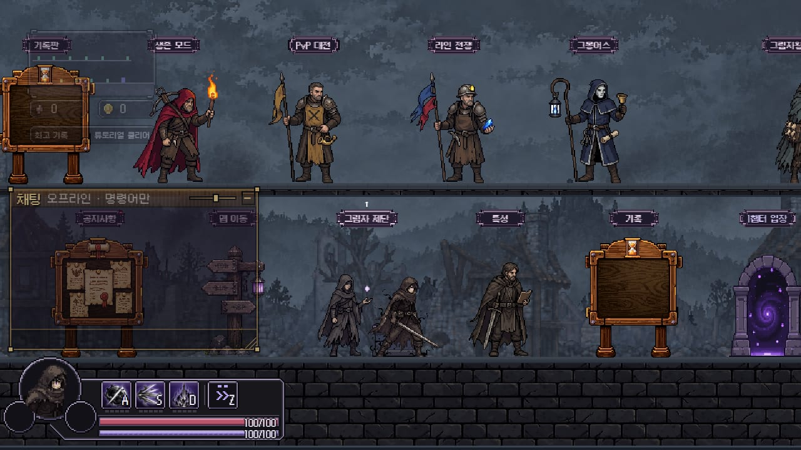
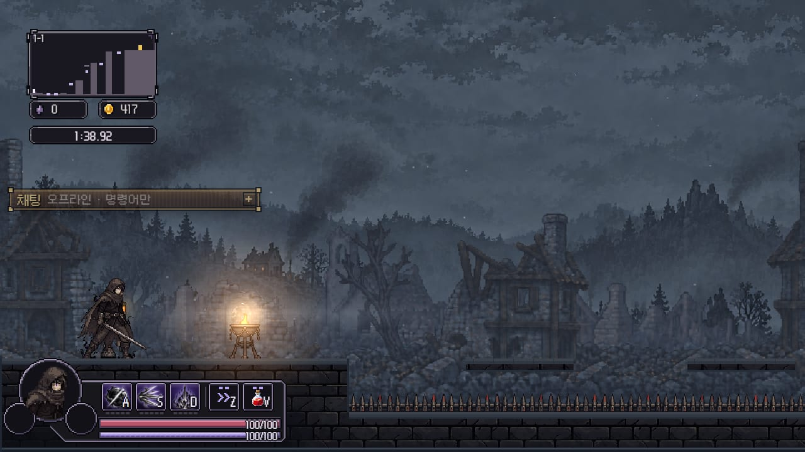
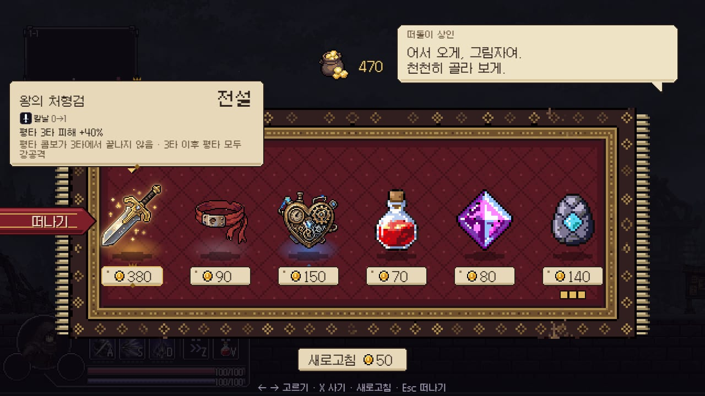
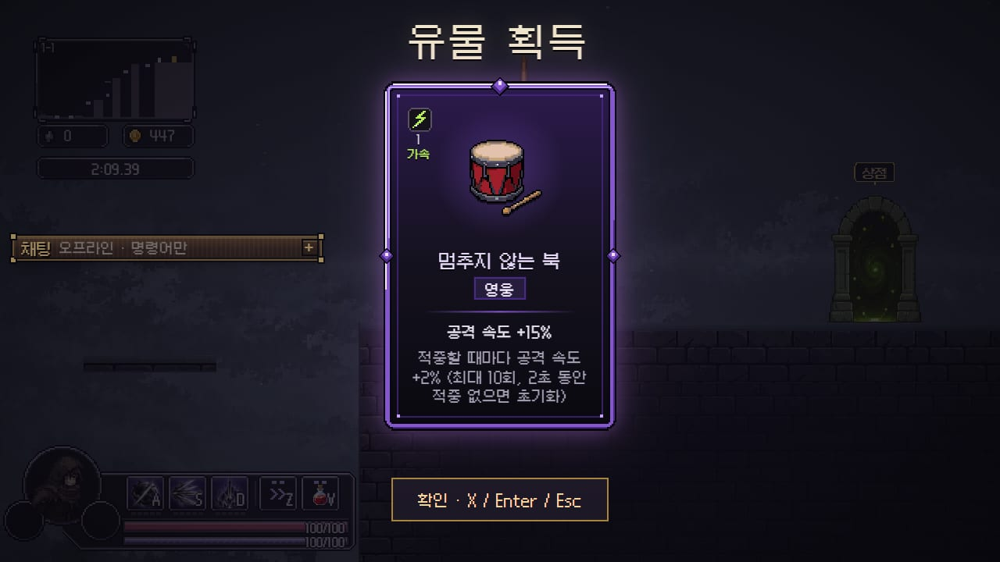
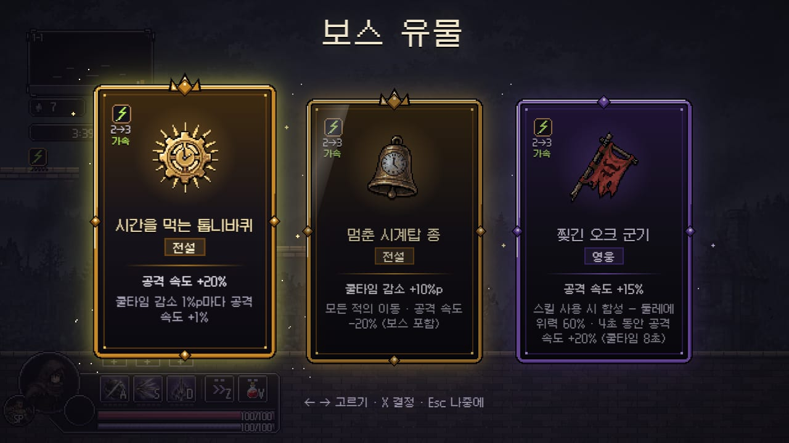
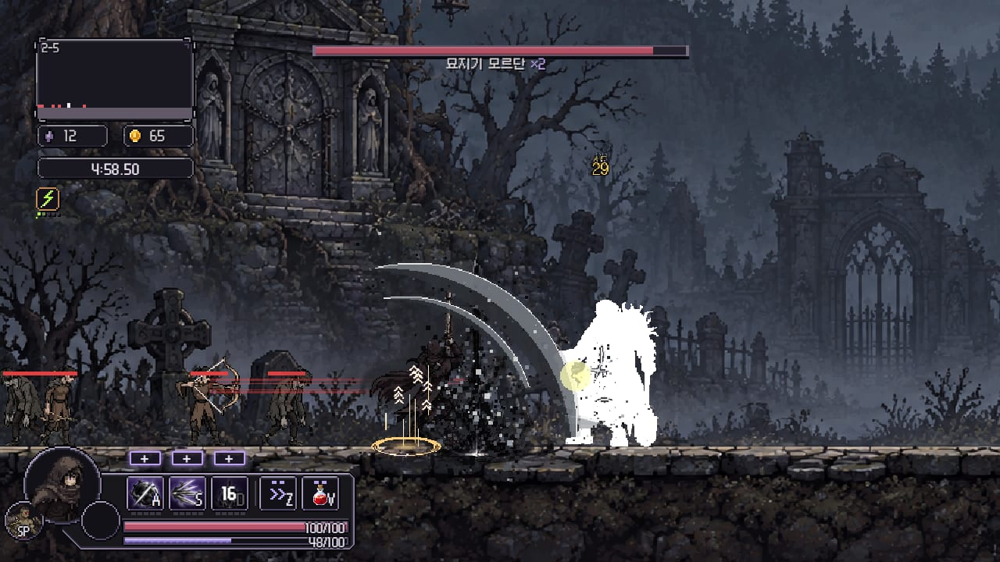
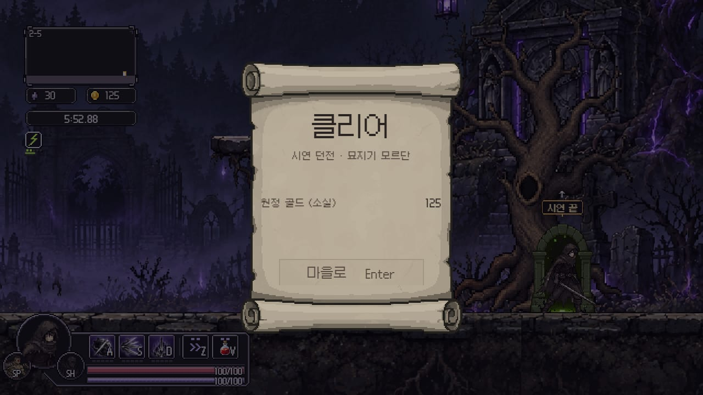
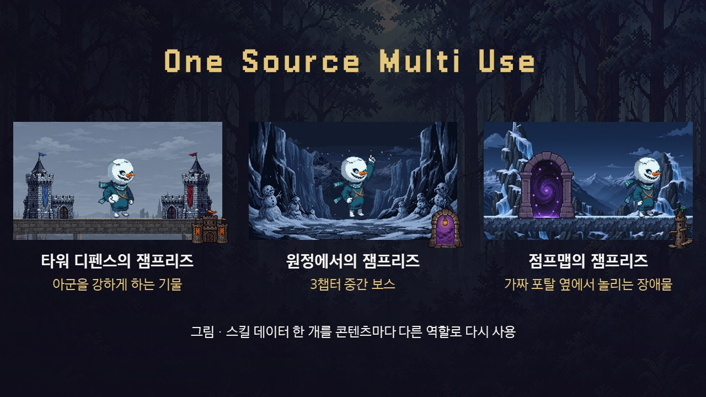

# 콘텐츠

[← README](../../README.md) · [컨셉과 세계관](concept.md) · [운영과 피드백](operation.md) · [에셋 제작](art-pipeline.md)

중심 콘텐츠는 원정이고, 운영 중에 서브 콘텐츠 7개를 더했습니다.

## 원정

광장의 포탈로 원정을 시작합니다. 방을 하나 깰 때마다 다음 방을 고르고, 정해진 수의 방을 지나면 보스방이 나옵니다. 챕터 막보스를 쓰러뜨리면 다음 챕터로 이어서 들어갑니다. 운영 종료 시점에는 폐허, 저주받은 숲, 얼음 산맥 세 챕터가 열려 있었습니다.

| 방 | 설명 |
|---|---|
| 일반방 | 몹을 모두 쓰러뜨리면 다음 방으로 가는 포탈이 열림 |
| 정예방 | 몹이 더 강하고 보상도 큼 |
| 특수방 (16종) | 회복 샘, 성소, 골드 도박, 피의 상점, 유물 합성, 함정 점프맵, 매복 투기장 등 |
| 보스방 | 쓰러뜨리면 그림자를 흡수하고 보스 유물을 고름 |

| 함정방 | 상점 | 유물 획득 |
|:---:|:---:|:---:|
|  |  |  |

원정 중 성장은 유물과 의태로 합니다. 유물은 140개이고 시너지 10종에 14개씩 속합니다. 같은 시너지 유물을 2, 4, 6, 8, 10개 모으면 단계별 효과가 켜집니다. 보스를 쓰러뜨리면 그 보스의 그림자를 얻어 의태할 수 있습니다 ([의태](concept.md#의태)).

| 보스 유물 선택 | 2챕터 막보스 | 원정 결과 |
|:---:|:---:|:---:|
|  |  |  |

## 서브 콘텐츠

| 콘텐츠 | 설명 | 인원 |
|---|---|---|
| 족쇄의 원정 | 제약 15가지 중 원하는 것을 걸고 하는 원정. 깬 제약마다 칭호를 줌 | 혼자 |
| 인내의 탑 | 전투 없이 장애물을 넘어 정상까지 가는 점프맵. 최단 기록으로 순위를 매김. 광장의 숨은 포탈로 들어감 | 혼자, 순위 |
| 심연의 탑 | 층을 계속 내려가며 얼마나 깊이 가는지 겨룸 | 혼자, 순위 |
| PvP | 흡수한 그림자로 다른 플레이어와 싸움. 개인전과 팀전, 최대 8명 | 여럿 |
| 그몽어스 | 숨어 있는 잠입자를 찾아내는 추리 게임. 회의 채팅으로 투표 | 여럿 |
| 생존 모드 | 계속 몰려오는 적을 버티는 모드. 최대 4명 협동 | 혼자, 여럿 |
| 라인 전쟁 | 병력을 골라 배치해 상대 진영을 무너뜨리는 1:1 대전. 혼자 하는 무한의 탑도 있음 | 혼자, 여럿 |

<!-- TODO: 서브 콘텐츠 영상 (YouTube) 링크 -->

### 서브 콘텐츠를 빠르게 만든 방법

서브 콘텐츠는 원정에 쓴 보스, 스킬, 맵을 최대한 다시 쓰는 방식으로 만들었습니다 (팀에서는 One Source Multi Use 라고 불렀습니다). 예를 들어 3챕터 중간 보스 잼프리즈는 원정에서는 보스이고, 타워 디펜스에서는 아군을 강화하는 기물, 점프맵에서는 가짜 포탈 옆에 서 있는 장애물로 나옵니다.

새 모드를 만들 때 그림부터 새로 그리지 않아도 되니, 3주 남짓한 운영 기간에 서브 콘텐츠 7개를 내놓을 수 있었습니다. 왜 서브 콘텐츠를 늘렸는지는 [운영과 피드백](operation.md#피드백을-보고-콘텐츠를-늘린-과정)에 정리했습니다.

## itch.io 싱글 판

[jkhm.itch.io/grize](https://jkhm.itch.io/grize)

운영 서버가 닫혀도 게임을 해 볼 수 있도록 서버와 멀티플레이를 빼고 브라우저에서만 돌아가게 다시 묶었습니다.

- 들어 있는 것: 원정, 족쇄의 원정, 인내의 탑, 심연의 탑, 생존 모드(혼자)
- 빠진 것: PvP, 그몽어스, 라인 전쟁 대전처럼 서버가 있어야 하는 모드
- 광장을 싱글 판에 맞게 새로 꾸몄습니다. 광장 배경과 사제 NPC 는 제가 만들었습니다 ([에셋 제작](art-pipeline.md))
- 진행 기록은 브라우저에만 저장됩니다
