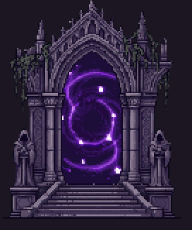

# 담당 업무

[← README](../README.md) · [기술 구조](tech/architecture.md) · [서버 권위 원정과 보안](tech/server-authority.md) · [인프라와 배포](tech/infra.md) · [에셋 제작](game/art-pipeline.md)

7명 팀에서 인프라와 백엔드를 맡았습니다. 서버 쪽 기반(DB 설계, API 명세, 인증, 원정 저장 구조)을 만들고, 게임을 실제 서비스로 띄워 운영하는 일(배포, 서버 관리, 백업)을 했습니다. 후반에는 보스 하나와 itch 판 광장의 그림을 만들었고, 최종 발표를 준비해 발표했습니다.

## 작업 내역

| 시기 | 작업 | Jira |
|---|---|---|
| 10.20 ~ 10.23 | 원정 상태 저장과 동기화 정책, 원정 API 명세, 서버 연동 시 주의사항 문서, DB 스키마와 ERD | S15P31C103-47, 52, 65, 87 |
| 10.26 | Docker Compose 정리 (외부 노출 차단, 필수 비밀값 검사, 자동 재시작, 메모리 상한), nginx 업스트림을 요청 시점에 찾게 변경, actuator 외부 차단 | -85, -83 |
| 10.26 | HTTPS 적용과 인증서 자동 갱신, 서비스 이름 변경(Project Shadow → Grize) | -118, -117 |
| 10.26 | Flyway 로 MySQL 스키마 작성, 로그인 세션과 묶인 JWT 인증과 프로필, 이메일 가입과 로그인 | -82 |
| 10.26 | 서버 원정 첫 구현: 1-1 체크포인트 저장과 정산 | -81 |
| 10.27 | Jenkins 자동 배포와 `/jenkins/` 경로, 같은 커밋을 다시 빌드할 때 되돌리기 태그 유지 | -133 |
| 10.27 ~ 10.29 | 클라이언트 원정 진행을 서버 저장에 연결: 시드 기반 맵 조합, 5스테이지 20방 구성, 그림자 제단과 의태 획득, 갈림길, 적 드랍 수령, 상점 구매, 유물 보상 규칙, 특성 강화, 다른 기기로 원정 이어 하기 | -132 |
| 10.28 | 새 도메인 연결, 이전 주소 리다이렉트 | -164 |
| 10.29 | 운영(main, www)과 개발(develop, dev) 환경 분리, DB 매일 백업, 운영 배포를 수동 실행으로 전환 | -191, -197, -204 |
| 10.30 ~ 11.27 | 운영 서버 관리 (배포, 장애 대응, 지표 확인) | |
| 11.05 ~ 11.06 | 3챕터 보스 카이론: 동작 그림, 기술 이펙트, 공격 패턴, 이동, 의태했을 때 쓰는 기술 연결 | -246 |
| 11.09 ~ 11.18 | 최종 발표: 발표 자료, 대본, 운영 지표 정리, 발표 | |
| 11.19 ~ 11.20 | itch 판 광장 개편: 광장 배경 세 층, 시설 정리, 족쇄 시설, 원정 고르기 창, 사제 NPC 와 대화 화면 | |

커밋은 develop 59개, itch 판 4개입니다.

### 만든 에셋

| 카이론 | 광장 사제 | 떼사냥꾼 | 원정 포탈 |
|:---:|:---:|:---:|:---:|
|  |  |  |  |

이 밖에 itch 판 광장 배경과 마계 단층 배경, 광장 대화 화면과 공지 UI 를 만들었습니다. 만드는 과정은 [에셋 제작](game/art-pipeline.md)에 있습니다.

## 설계하면서 정한 것

| 결정 | 이유 |
|---|---|
| CI 로 GitLab Runner 대신 Jenkins 를 씀 | 학교 GitLab 은 저장소가 옮겨지거나 만료될 수 있어서, 특정 Git 호스트 기능에 묶이지 않게 함. 저장소를 옮기면 job 주소, 읽기 토큰, 웹훅만 바꾸면 됨 |
| 운영과 개발을 하위 도메인으로 나눔 | 로그인 쿠키, 브라우저 저장소, Google 로그인 허용 출처가 주소 단위라 경로로 나누면 두 환경이 섞임 |
| 운영은 자동 배포하지 않음 | main 병합이 곧 서비스 교체가 되지 않게, 담당자가 직접 빌드를 실행해야 반영 |
| 내부 포트는 모두 127.0.0.1 에만 묶음 | Docker 가 연 포트는 서버 방화벽을 거치지 않아서, compose 의 `ports:` 를 외부 공개 목록으로 관리 |
| 원정 계획은 서버만 갖고, 쓰기 요청은 멱등 키와 revision 으로 검사 | 혼자 하는 모드라도 랭킹과 영구 재화가 걸려 있어 위조, 중복 요청, 두 기기 동시 저장을 서버에서 막아야 함 |
| refresh 토큰은 DB 에 해시만 저장하고, 쿠키는 HttpOnly 와 Secure 로 보냄 | DB 가 유출되거나 페이지 스크립트가 탈취돼도 토큰 원문이 드러나지 않게 함 |
| 백업은 cron 대신 systemd 타이머로, 개발 DB 도 백업 | 실행 기록이 남고 놓친 실행을 다시 돌릴 수 있음. 개발 서버에도 팀 테스트 데이터가 쌓임 |

## 돌아보며

잘된 점

- 개발 3주째에 실서비스를 열었고, 환경을 나눈 뒤로는 develop 에 병합하기만 하면 개발 서버에 자동으로 배포돼서 팀이 하루에도 여러 번 배포할 수 있었습니다. 운영 기간 동안 개발 470회 넘게, 운영 41회 배포했습니다.
- 배포 절차를 스크립트 하나에 모아 두어서 Jenkins 나 GitLab 에 문제가 생겨도 서버에서 같은 명령으로 배포할 수 있었습니다.
- 원정 저장 구조를 처음부터 서버가 계획을 갖는 방식으로 잡아 두어서, 나중에 위조 기록이 나왔을 때 팀이 그 위에 허니팟과 이상 기록 탐지를 붙일 수 있었습니다.

아쉬운 점

- 서버 한 대에 모든 것을 올렸고 백업도 같은 디스크에 있었습니다. 서버 밖 백업과 복원 연습을 하지 못했습니다.
- 무중단 배포가 아니어서 배포할 때마다 API 가 15초가량 멈췄습니다.
- 알림 규칙을 만들어 두고도 알림을 받을 곳을 연결하지 않아, 장애를 대시보드에서 직접 찾아야 했습니다.

개발 과정에서 AI 코딩 도구를 활용했습니다.
