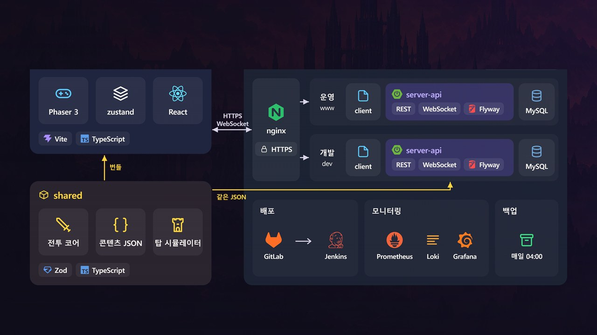
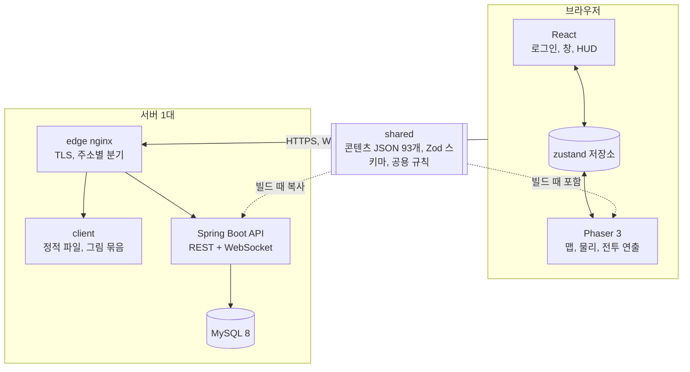
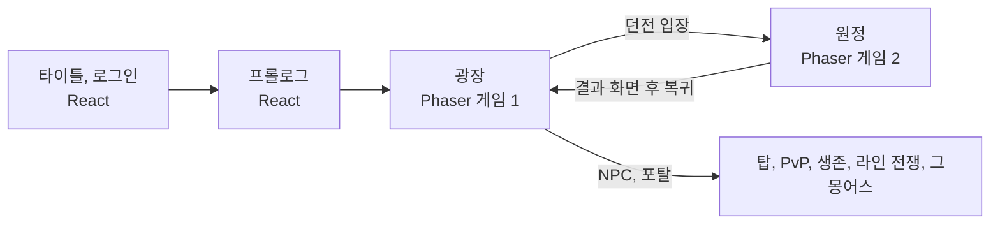

# 기술 구조

[← README](../../README.md) · [서버 권위 원정과 보안](server-authority.md) · [실시간 동기화](realtime.md) · [인프라와 배포](infra.md) · [트러블슈팅](troubleshooting.md) · [예상 질문](qna.md)



## 구성 요소



| 폴더 | 역할 | 기술 |
|---|---|---|
| client | 게임 화면. Phaser 가 맵과 물리, 전투 연출을, React 가 로그인 화면과 창, HUD 를 그림 | TypeScript, Phaser 3, React, zustand, Vite |
| shared | 클라이언트와 서버가 같이 쓰는 콘텐츠 데이터와 검증 스키마, 화면과 무관한 규칙(체력, 의태 게이지, 유물 발동, 드랍), 실시간 메시지 타입 | TypeScript, Zod |
| server-api | 계정, 프로필, 원정 판정, 랭킹, 실시간 방, 채팅, 공지, 운영자 기능 | Java 21, Spring Boot 3, JdbcTemplate, Flyway |
| infra | edge nginx, Jenkins, 배포 스크립트, 모니터링, DB 백업 | Docker Compose, nginx, Jenkins, Prometheus, Grafana, Loki |

## shared: 콘텐츠 데이터와 공용 규칙

보스 체력, 스킬 쿨타임, 유물 효과 같은 수치는 팀 위키(게임 설정 문서)에서 정하고, 그 값을 `shared/data` 의 JSON 으로 옮겨 씁니다. 클라이언트와 서버가 이 JSON 한 벌을 같이 읽기 때문에, 7명이 동시에 콘텐츠를 고쳐도 기획 문서와 게임의 숫자가 따로 놀지 않았습니다.

```
게임 설정 위키 (규칙 원본. 아직 정하지 않은 숫자는 null)
  → shared/data/*.json
     ├─ Zod 스키마와 참조 검사 → 테스트 (스키마, id 참조, 그림 경로, 맵을 끝까지 갈 수 있는지)
     ├─ 클라이언트: 시작할 때 검사, 데이터가 틀리면 게임이 뜨지 않음
     └─ 서버: 빌드할 때 같은 JSON 을 복사해서 읽음
  콘텐츠 해시: 양쪽이 같은 방법(키를 정렬한 JSON → SHA-256)으로 계산
  → 원정을 시작할 때 비교해서 다르면 「게임이 업데이트되었습니다」 안내
```

- 위키에서 아직 정하지 않은 숫자는 임의로 채우지 않고 `null` 로 두고, 코드에서 미정 값을 처리합니다.
- Java 서버는 TypeScript 코드를 실행하지 않습니다. 같은 JSON 을 읽을 뿐이고, 판이 다르면 해시 비교에서 드러납니다.

## 화면 구조

- Phaser 장면은 사실상 `BattleScene` 하나입니다. 광장, 원정 방, 탑, PvP, 생존 모드가 모두 같은 장면 클래스이고 「어떤 장소인지」 값만 다릅니다. 방을 옮길 때마다 장면을 새로 만듭니다.
- 로그인, 광장, 원정처럼 큰 단계 전환은 React 가 맡습니다. 광장과 원정은 서로 다른 Phaser 게임 인스턴스로 돌립니다.
- 둘은 zustand 저장소로 이어집니다. 전투 장면이 매 프레임 체력과 쿨타임을 저장소에 쓰면 HUD 가 그 값을 읽어 그리고, 창이 열리면 게임 루프를 멈춥니다.



## 서버 구조

- 기능별 패키지마다 Controller 와 Service 두 층으로 나눴고, 데이터 접근은 JdbcTemplate 으로 SQL 을 직접 씁니다.
- DB 스키마 변경은 Flyway 마이그레이션(V1 ~ V39)으로만 합니다.
- 로그인은 이메일과 비밀번호(가입할 때 메일 인증 코드 확인), 또는 Google ID 토큰으로 합니다. access 토큰(JWT, 1시간)은 브라우저 메모리에만 두고, refresh 토큰(14일)은 HttpOnly 쿠키로 보내며 DB 에는 해시만 저장합니다.
- 한 계정은 한 창에서만 플레이할 수 있습니다. 창마다 고유 id 를 요청에 싣고, 다른 창에서 접속하면 먼저 연 창은 연결이 끊깁니다.
- 실시간 기능은 WebSocket 연결 하나 위에 방 종류(광장, PvP, 협동, 라인 전쟁, 그몽어스, 카드 대전)를 나눠 올렸습니다. → [실시간 동기화](realtime.md)

| 영역 | 주요 API |
|---|---|
| 인증 | `/auth/register`, `/auth/login`, `/auth/google/*`, `/auth/refresh` |
| 프로필, 성장 | `/me`, `/me/upgrades`, `/me/carried-shadows` |
| 원정 | `/runs` 시작, `rooms/enter`, `rooms/{id}/clear`, `shadows/claim`, `advance`, `finish`, `abandon`, `fail` |
| 랭킹, 탑 | `/rankings`, `/climb/start`, `/climb/zone`, `/climb/clears` |
| 실시간 | `/realtime/tickets` 로 입장권을 받은 뒤 `/realtime/ws` 접속 |

## 테스트

| 영역 | 확인하는 것 |
|---|---|
| shared | 데이터 스키마, id 참조, 그림 경로, 맵을 끝까지 갈 수 있는지, 같은 시드면 같은 맵이 나오는지, 유물 발동 규칙 |
| client | 실시간 재연결, 보간, 보스 코드 구조 규칙, 맵 도달 가능성 |
| server-api (358개) | 실제 MySQL 컨테이너를 띄워 인증, 원정 위조 방어, 방 최소 시간, 랭킹, 실시간 방(PvP, 협동, 라인 전쟁)을 확인 |
