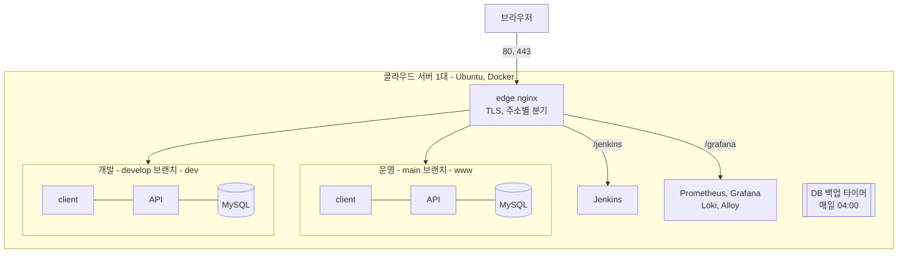
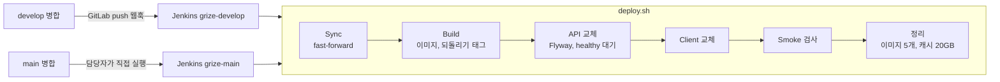

# 인프라와 배포

[← README](../../README.md) · [기술 구조](architecture.md) · [서버 권위 원정과 보안](server-authority.md) · [실시간 동기화](realtime.md) · [트러블슈팅](troubleshooting.md) · [예상 질문](qna.md)

아무것도 설치되지 않은 서버에 Docker 를 까는 것부터 시작해 compose 설정, nginx, HTTPS, 도메인, Jenkins 자동 배포, 운영과 개발 환경 분리, DB 백업까지 제가 설계하고 구축했습니다. 운영 기간 동안 서버 관리도 맡았습니다. 모니터링 스택(6절)은 팀원 송XX 가 주로 만들었습니다.

## 1. 서버 구성

- 운영(`www`)은 main 브랜치, 개발(`dev`)은 develop 브랜치를 띄우고, 주소마다 client, API, DB 를 따로 둡니다.
- 운영과 개발을 경로(`/dev/`)가 아니라 하위 도메인으로 나눴습니다. 로그인 쿠키, 브라우저 저장소, Google 로그인의 허용 출처가 모두 주소 단위로 묶여서, 경로로 나누면 두 환경의 로그인 상태와 저장 데이터가 섞이기 때문입니다.
- edge nginx, Jenkins, 모니터링, 백업만 두 환경이 같이 씁니다. edge nginx 를 앱 묶음과 분리해 두어 개발 환경을 내렸다 올려도 운영은 영향을 받지 않습니다.
- 정식 주소는 `www` 하나로 정했습니다. 도메인 원형, 이전 주소, IP 로 들어오면 `www` 로 301 리다이렉트합니다.

## 2. 요청 경로

| 경로 | 대상 | 비고 |
|---|---|---|
| `/` | client 컨테이너 | 내용 해시가 붙은 그림은 1년 캐시, HTML 은 매번 확인 |
| `/api/` | API 컨테이너 | 주소에 `;` 가 있으면 400 (경로 파라미터로 차단 규칙을 우회하는 것을 막음) |
| `/api/realtime/ws` | API 의 WebSocket | Upgrade 헤더 전달, 버퍼링 끔 |
| `/api/actuator/health` | API | actuator 는 health 만 외부에 열고 나머지는 404 |
| `/jenkins/`, `/grafana/` | Jenkins, Grafana | `www` 에서만 |

- 인증서는 Let's Encrypt 를 쓰고, nginx 를 멈추지 않는 webroot 방식으로 발급합니다. 갱신되면 hook 이 nginx 를 다시 읽게 합니다.
- 업스트림 컨테이너 주소를 요청마다 Docker DNS 로 찾게 했습니다. 고정해 두면 앱 컨테이너 하나가 내려가 있을 때 nginx 전체가 뜨지 않는데, 이렇게 하면 해당 경로만 502 가 납니다.
- nginx 설정은 파일이 아니라 폴더 단위로 마운트했습니다. 파일 하나만 마운트하면 git 이 파일을 새로 쓸 때 컨테이너가 바뀐 내용을 보지 못합니다.

## 3. 외부 노출 최소화

클라우드 방화벽은 콘솔 권한이 없어 넓게 열린 상태였고, 서버 방화벽(ufw)은 Docker 가 연 포트를 거르지 못합니다(Docker 규칙이 ufw 보다 먼저 적용됨). 그래서 compose 파일의 `ports:` 가 곧 외부 공개 목록이라고 보고 설계했습니다.

- 외부에 여는 포트는 edge nginx 의 80, 443 뿐이고 API, DB, Jenkins, Grafana 는 모두 `127.0.0.1` 에만 묶었습니다.
- 필수 비밀값이 비어 있으면 컨테이너가 시작되지 않게 했고(`${VAR:?}`), `.env` 는 권한을 600 으로 두고 빌드 context 에서 뺐습니다.
- 컨테이너마다 메모리 상한과 자동 재시작을 걸었습니다. MySQL 헬스체크는 TCP 로 확인합니다. 소켓으로 ping 하면 초기화가 끝나기 전에도 정상으로 나오는 문제가 있었습니다.

## 4. 자동 배포

- GitLab Runner 대신 Jenkins 를 썼습니다. 학교 GitLab 은 저장소가 옮겨지거나 만료될 수 있어서 특정 Git 호스트 기능에 묶이지 않게 하려는 선택이었습니다. 저장소를 옮기면 job 주소, 읽기 토큰, 웹훅 세 곳만 바꾸면 됩니다.
- 배포 절차는 `deploy.sh` 한 파일에만 있습니다. Jenkinsfile 은 단계 이름으로 이 스크립트를 부르기만 해서, Jenkins 가 멈춰도 서버에서 같은 명령으로 배포할 수 있습니다.
- 운영은 자동으로 배포하지 않습니다. main 에 병합하는 순간 서비스가 바뀌지 않도록, 담당자가 Jenkins 에서 빌드를 실행해야 운영에 반영됩니다.
- 빌드할 때 그 시점에 돌던 이미지에 `rollback` 태그를 붙여 두고, 문제가 생기면 그 이미지로 되돌립니다. 같은 커밋을 다시 빌드할 때는 태그를 옮기지 않습니다. 웹훅 테스트 한 번에 직전 판을 잃은 적이 있어 고친 부분입니다.
- 배포가 끝나면 공개 주소로 페이지(200), health(200), 로그인이 필요한 API(401), 콘텐츠 해시 응답을 확인하고, 하나라도 실패하면 그 자리에서 멈춥니다.
- 운영 기간 동안 운영 41회, 개발 470회 넘게 배포했습니다. 무중단 배포는 아니어서 API 를 교체할 때 약 15초 동안 요청이 실패했고, 이 정도는 감수하기로 했습니다.

## 5. DB 백업

- systemd 타이머로 매일 04:00(KST)에 운영 DB 와 개발 DB 를 각각 덤프합니다 (`mysqldump --single-transaction` 후 gzip).
- 덤프마다 `gzip -t` 와 마지막 줄의 「Dump completed」를 확인합니다. 디스크 여유가 2GB 보다 적으면 건너뛰고, 잠금 파일로 두 백업이 겹쳐 돌지 않게 했습니다.
- 14일 동안 보관하되, 날짜와 상관없이 최신 7개는 남깁니다.
- 복원 절차는 스크립트 끝에 적어 두었습니다. 현재 상태를 한 번 더 백업하고, API 를 멈춰 쓰기를 막은 뒤 복원하고, API 를 다시 띄우는 순서입니다.

## 6. 모니터링과 로그

> 팀원 송XX 가 주로 구성했고, 저는 운영 네트워크 연결, 지표 엔드포인트 토큰 보호, nginx 경로를 맡았습니다.

| 도구 | 수집 대상 |
|---|---|
| Prometheus | 서버(node-exporter), 컨테이너(cAdvisor), MySQL, API 지표(토큰으로 보호한 actuator) |
| Loki, Alloy | 모든 컨테이너 로그 (14일 보관), Spring 로그 레벨을 라벨로 분리 |
| Grafana | 운영 대시보드, 플레이 분석 대시보드, 알림 규칙 10개 (대상 다운, 에러율, 응답 지연, DB 연결 고갈, 디스크, 메모리 등) |

접속 계정, 원정 수, 시간대별 활동 같은 지표는 최종 발표의 운영 성과 자료에도 썼습니다.

## 7. 운영 중 생긴 문제

| 문제 | 원인 | 조치 |
|---|---|---|
| 배포가 커밋 목록 출력 단계에서 멈춤 | `git log \| head` 가 SIGPIPE(141)로 끝나면서 `pipefail` 에 걸림 | `git log -n 20` 으로 변경 |
| 웹훅 테스트 한 번에 되돌릴 이미지를 잃음 | 같은 커밋을 다시 빌드할 때도 `rollback` 태그를 옮김 | 같은 커밋이면 태그를 옮기지 않음 |
| 빌드 캐시가 104GB 까지 쌓임 | 정리 단계가 없었음 | 배포 끝에 캐시 20GB 상한 정리 추가 |
| 웹훅이 갑자기 404 | GitLab 이 웹훅 주소를 바꾸면서 비밀 토큰을 비움 | 토큰을 다시 넣고 점검 절차를 문서로 남김 |
| 대용량 파일(LFS) 다운로드 실패로 배포가 멈춤 | 발표 자료가 LFS 로 저장소에 들어옴 | LFS 다운로드를 건너뛰고 sparse checkout 적용 (팀원 조치) |

## 8. 아쉬운 점과 개선 방향

- 서버 한 대에 운영, 개발, CI, 모니터링, 백업이 모두 있었고 백업도 같은 디스크에 있었습니다. 백업을 오브젝트 스토리지처럼 서버 밖에 두었어야 합니다.
- 무중단 배포가 아니었습니다. API 를 두 벌 띄워 교체하는 블루그린 방식으로 바꿀 수 있습니다.
- 알림 규칙은 만들었지만 알림을 받을 곳(Alertmanager)을 연결하지 못해, 장애를 사람이 대시보드에서 찾아야 했습니다.
- 관리 화면(`/jenkins`, `/grafana`)은 앱 로그인만 걸고 외부에 열어 두었습니다. 앞단 인증을 추가하거나 내부망에서만 접근하게 해야 합니다.
