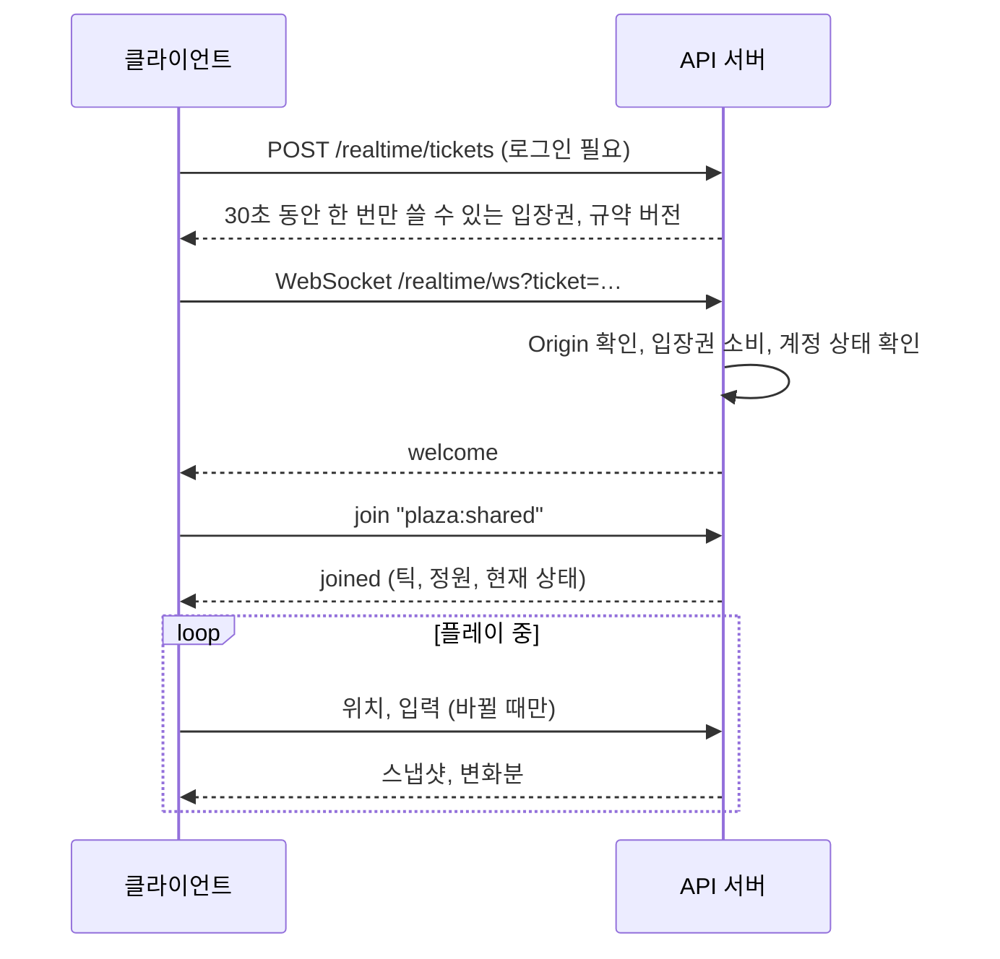

# 실시간 동기화

[← README](../../README.md) · [기술 구조](architecture.md) · [서버 권위 원정과 보안](server-authority.md) · [인프라와 배포](infra.md) · [트러블슈팅](troubleshooting.md) · [예상 질문](qna.md)

> 실시간 서버와 멀티 콘텐츠는 팀원(이XX 등)이 주로 구현했고, 그 아래의 인증과 배포, nginx 의 WebSocket 경로를 담당했습니다.

멀티 콘텐츠는 API 서버 안의 WebSocket 연결 하나에 방 종류를 나눠 올렸습니다. 콘텐츠마다 공정성이 얼마나 중요한지에 따라 동기화 방식을 다르게 골랐습니다.

## 콘텐츠별 방식

| 콘텐츠 | 방식 | 서버 틱 | 정원 | 설명 |
|---|---|---|---|---|
| 광장 | 중계 | 초당 15회 | 채널당 50명 | 각자 보낸 위치와 모습을 모아 바뀐 것만 다시 보냄. 받는 쪽은 120ms 전 시점으로 보간해 그림 |
| PvP | 서버 권위 | 초당 50회 | 2 ~ 8명 | 이동, 평타, 피격, 체력을 서버가 계산. 스킬 명중 보고도 두 사람의 거리와 무적 여부 등을 보고 서버가 다시 판단 |
| 협동 생존 | 호스트 권위 | | 2 ~ 4명 | 같은 편끼리 하는 모드라 방장 브라우저가 몹을 계산하고 서버는 중계만 함 |
| 라인 전쟁 | 락스텝 | 초당 20틱 | 1:1 | 서버가 명령을 3틱 뒤에 실행되도록 나눠 주고, 양쪽 상태의 해시만 비교 |
| 그몽어스 | 서버 권위 | 초당 10회 | 방마다 다름 | 서버가 게임 상태를 계산해 내려줌 |

승패와 기록이 갈리는 모드일수록 서버가 더 많은 부분을 계산하게 했고, 협동 모드는 서버 부담을 줄이는 쪽을 택했습니다.

## 연결 과정

## 서버 쪽 안정화 장치

- 입장권: 쿠키 대신 30초짜리 1회용 입장권으로 WebSocket 을 엽니다.
- 보내기 큐: 연결마다 보낼 메시지 줄을 따로 두고 공용 스레드가 비웁니다. 느린 연결 하나 때문에 다른 사람이 늦어지지 않도록, 밀리면 오래된 메시지부터 버리고 3초 넘게 막히면 연결을 닫습니다.
- 받기 제한: 연결마다 초당 100개(순간 150개)까지만 받습니다. 계속 넘치면 연결을 닫습니다.
- 끊김 감지: 3초 동안 아무것도 오지 않으면 ping 을 보내고, 15초가 지나면 닫습니다. 와이파이가 끊기거나 노트북을 덮어 종료 신호 없이 끊긴 경우를 위한 장치입니다. PvP 와 협동은 60초 안에 다시 들어올 수 있습니다.
- 잠금 순서: 방 입장, 퇴장, 메시지, 틱 처리는 방 단위 잠금으로 순서를 정하고, 끊긴 연결 정리는 전용 스레드에서 해서 교착을 피했습니다.
- 변화분 전송: 광장은 바뀐 사람만, PvP 는 1초마다 전체 상태를 보내고 그 사이에는 바뀐 부분만 보냅니다.

## 성능 개선 수치

| 항목 | 이전 | 이후 |
|---|---|---|
| PvP 에서 상대가 늦게 보이는 시간 | 약 250ms | 약 115ms (전송 초당 15 → 30회, 보간 150 → 80ms. 이후 초당 50회, 60ms 로 한 번 더 조정) |
| 광장 상태 메시지 (5명 걷기 + 1명 기술) | 2,770B | 1,514B (45% 감소) |
| 내 캐릭터 상태 메시지 | 255B | 117B (54% 감소) |

자세한 내용은 [트러블슈팅](troubleshooting.md#3-pvp-에서-상대가-늦게-보였던-문제)에 있습니다.
