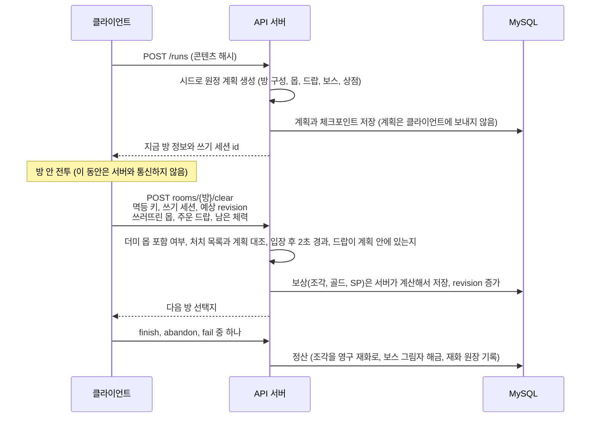
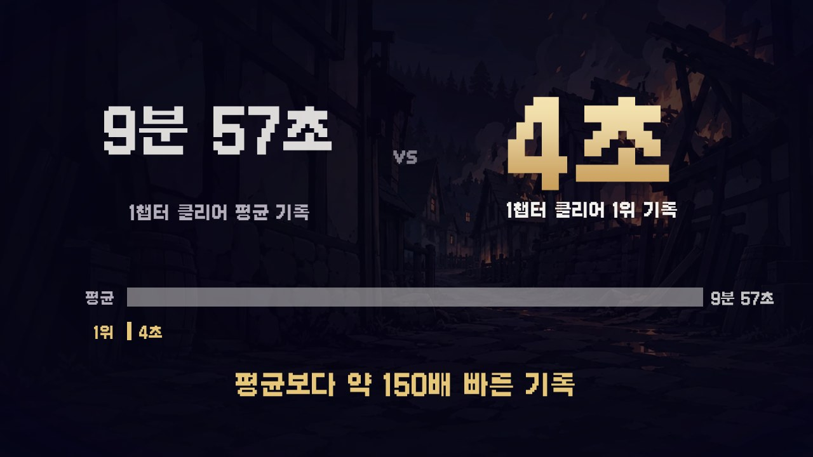
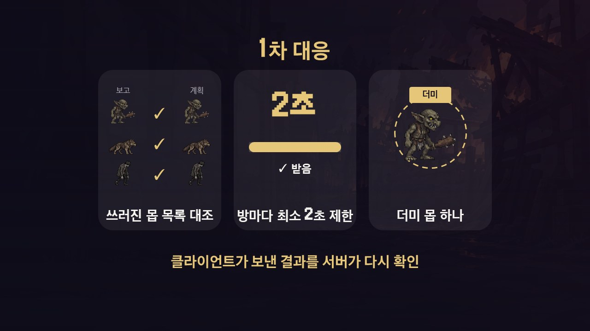
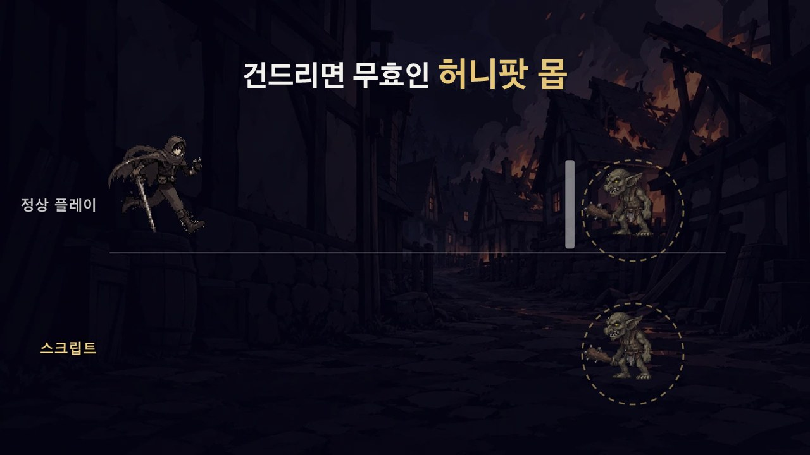
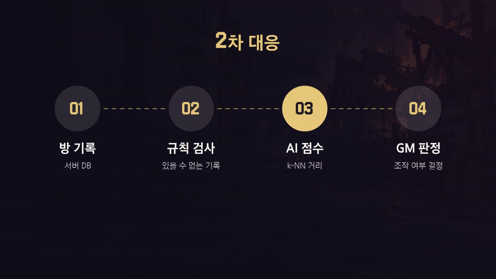

# 서버 권위 원정과 보안

[← README](../../README.md) · [기술 구조](architecture.md) · [실시간 동기화](realtime.md) · [인프라와 배포](infra.md) · [트러블슈팅](troubleshooting.md) · [예상 질문](qna.md)

원정은 싱글플레이 모드지만 랭킹과 영구 재화가 걸려 있습니다. 클라이언트가 보낸 결과를 그대로 저장하면 기록 조작이 바로 다른 플레이어에게 피해가 될 수 있기 때문에, 판정에 필요한 정보는 서버가 갖도록 설계했습니다. 원정 저장 구조와 API 명세, 서버 쪽 첫 구현(체크포인트, 정산)을 구현하였고, 이후 팀원에 의해 구체적인 변조 대응이 추가되었습니다.

## 원정 한 판의 흐름

## 서버가 확인하는 것

| 대상 | 방법 |
|---|---|
| 원정 계획 | 방 구성, 몹, 드랍, 보스, 상점은 서버만 알고 있음. 클라이언트에는 지금 방의 몹과 드랍만 보냄 |
| 같은 요청이 두 번 오는 경우 | 쓰기 요청마다 멱등 키를 받음. 같은 키로 다시 오면 저장해 둔 응답을 돌려줌 |
| 두 기기에서 동시에 저장하는 경우 | 예상 revision 비교, 쓰기 세션, 행 잠금으로 하나만 반영. 다른 기기에서 이어 하면 이전 기기는 쓰기 권한을 잃음 |
| 1인 1원정 | DB UNIQUE 제약 |
| 보상 | 조각, 골드, SP 는 클라이언트가 보낸 값이 아니라 계획값으로 서버가 계산 |
| 랭킹 시간 | 서버 시계로 잼. 클라이언트는 일시정지와 재개 신호만 보내고, 시각은 서버가 기록 |
| 오래된 클라이언트 | 규약 버전 헤더가 낮으면 426 응답으로 새로고침을 안내 |
| 콘텐츠 판 | 클라이언트와 서버의 콘텐츠 해시가 다르면 새 원정을 막음. 진행 중인 원정은 새 판으로 옮길 수 있음 |

## 기록 위조 문제와 대응

1챕터를 열었을 때 평균 클리어 시간은 9분 57초였는데 랭킹 1위는 4초로 집계되는 사례가 있었습니다. 초기 서버는 클라이언트가 「방을 깼다」고 보내면 그대로 받아들였기 때문에, 싸우지 않고 클리어 요청만 연달아 보내도 다음 방으로 넘어갔습니다. 브라우저 게임 구조상 개발자 도구를 열면 호출하는 API 가 그대로 보입니다.

### 1차 대응

- 클라이언트가 보낸 처치 목록을 서버의 원정 계획과 대조합니다.
- 방에 들어간 뒤 서버 시계로 최소 2초가 지나야 클리어를 받습니다.
- 방마다 더미 몹을 하나씩 섞어 둡니다.

### 허니팟 몹

첫 더미는 항상 같은 몹이었고 드랍도 없어서, 팀이 직접 공격해 보니 콘솔에서 바로 걸러졌습니다. 다음 날 더미를 진짜 몹과 구별하기 어렵게 바꿨습니다.

- 더미는 맵에 놓지 않고 서버가 보내는 몹 목록에만 넣습니다. 맵에 자리가 없으니 정상 클라이언트는 받자마자 빼고 그리지 않고, 정상적으로 플레이해서는 건드릴 수 없습니다.
- 다른 방 맵에 있는 진짜 몹의 종류와 자리 이름을 빌려 오고, 드랍도 그 방의 드랍표대로 만듭니다.
- 자리 이름은 맵의 번호를 이어서 붙입니다. P01 ~ P05 가 있는 방이면 P06 이나 다른 글자의 1번을 씁니다. 번호를 잇는 경우와 새 글자를 쓰는 경우를 반씩 섞어서, 가장 큰 번호만 빼는 식으로는 골라낼 수 없게 했습니다.
- 목록 안 위치는 맨 앞만 피해 무작위로 정합니다. 더미는 저장하지 않고, 원정 시드와 방 번호로 매번 같은 더미를 다시 만듭니다.
- 요청에 더미 몹이나 그 드랍의 id 가 들어오면 그 원정은 무효가 되고 보상은 정산되지 않습니다. 어느 계정이 어느 방에서 무엇을 건드렸는지 DB 에 남기고, 서버 로그와 모니터링 지표에도 기록합니다.

### 결과만으로는 알 수 없는 조작

이동 속도를 두 배로 올리거나 피해를 열 배로 키우는 조작은 처치 순서와 시간이 그럴듯하게 맞기 때문에, 서버가 결과만 봐서는 알아낼 수 없습니다. 서버가 전투 자체를 다시 계산하지는 않기 때문입니다.

### 2차 대응: 이상 기록 탐지

1. 클리어 요청마다 그 방의 전투 기록(피해, 처치, 시간)을 서버 DB 에 남깁니다.
2. 정상 플레이로는 나올 수 없는 기록은 규칙 검사로 바로 GM 확인 대상에 올립니다.
3. 나머지 기록은 k-NN 거리로 이상 점수를 매깁니다.
4. 점수가 높은 기록을 GM 이 직접 보고 조작이면 랭킹에서 뺍니다.

| 항목 | 내용 |
|---|---|
| 특징 10개 | 시간 2개(클리어 시간, 게임 시계 ÷ 서버 시계), 피해 5개(초당 피해, 평균 한 방, 가장 센 한 방, 몹 하나당 깎은 체력, 받은 피해 속도), 처치 3개(처치 비율, 첫 처치까지 걸린 시간, 처치 간격이 고른 정도) |
| 표준화 | 같은 챕터, 스테이지, 방 종류끼리 중앙값과 MAD 로 맞추고, 의심스러운 방향만 반영. 플레이가 서툰 사람은 목록에 뜨지 않음 |
| 점수 | 가장 가까운 정상 방 5개까지의 평균 거리를 정상 기록 중 상위 몇 % 인지로 바꿈 |
| k-NN 을 고른 이유 | 조작 라벨이 없어서 비지도 방식을 씀. 비지도 모델 7종의 AUC 가 0.76 ~ 0.79 로 비슷했는데, k-NN 은 「가장 비슷한 정상 기록」을 GM 에게 같이 보여 줄 수 있음. 속도 2배 조작을 정상 기록 1% 만 검토하는 조건에서 k-NN 은 93%, Isolation Forest 는 2% 를 찾았고, 다른 조작으로 학습한 지도 모델은 처음 보는 조작에 AUC 0.53 이었음 |

## 한계

- 맵 데이터가 클라이언트 번들에 들어 있어서, 맵과 대조해 더미를 걸러 내는 스크립트까지 막지는 못합니다. 목표는 완전 차단이 아니라 우회 비용을 높이고, 걸리면 기록을 남기는 것이었습니다.
- 공정성이 가장 중요한 PvP 는 서버가 전투를 직접 계산합니다. → [실시간 동기화](realtime.md)
- 11월 12일 집계 기준으로 운영 서버에서 허니팟에 걸린 원정은 없었습니다.

> 1차, 2차 대응과 허니팟, 이상 기록 탐지는 팀원과 협업하였고, 그 바탕인 원정 저장 구조(계획 비공개, 체크포인트, 정산, 멱등 저장)를 직접 설계하고 구현했습니다.
