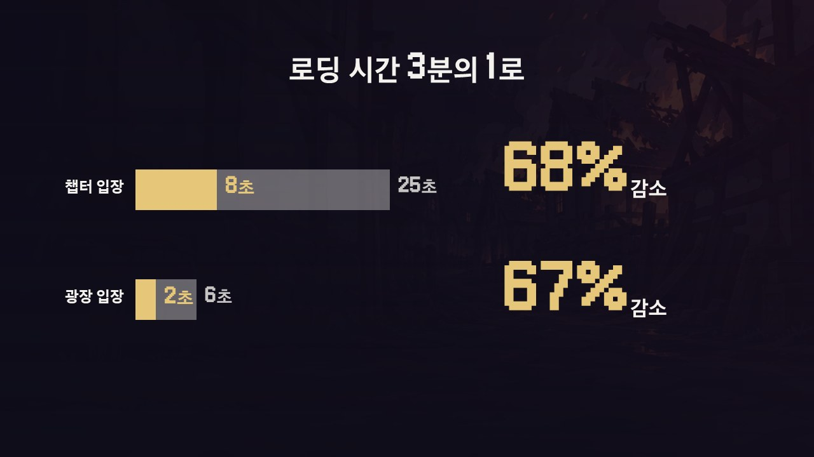

# 트러블슈팅

[← README](../../README.md) · [기술 구조](architecture.md) · [서버 권위 원정과 보안](server-authority.md) · [실시간 동기화](realtime.md) · [인프라와 배포](infra.md) · [예상 질문](qna.md)

> 이 문서의 1, 3, 4, 5번은 팀원(송XX, 이XX, 장XX)의 작업이고, 2번은 팀원이 대응을 구현했고 그 바탕인 원정 저장 구조를 직접 설계했습니다. 인프라 운영 중 직접 겪고 해결한 문제는 [인프라와 배포](infra.md#7-운영-중-생긴-문제)에 있습니다.

## 1. 입장할 때마다 로딩이 길었던 문제

설치 없이 하는 브라우저 게임인데 처음 받아야 하는 그림이 원정 246MB, 광장 48MB 였습니다. 챕터 하나에 들어가는 데 25초, 광장을 여는 데 6초가 걸렸고 「접속이 너무 느려요」라는 피드백이 실제로 들어왔습니다.

- 무손실 WebP: 도트 그림은 픽셀 하나만 달라져도 티가 나서 화질을 깎지 않는 무손실 WebP 를 골랐습니다. 바꾼 그림을 PNG 와 디코드해서 비교했을 때 차이는 0이었습니다.
- 빌드 단계 변환: 빌드 스크립트가 sharp 로 그림 묶음 안의 PNG 를 6장씩 병렬로 바꾸고, PNG 내용의 해시로 결과를 캐시해 다음 빌드부터는 바뀐 그림만 다시 만듭니다. 처음 전체를 변환할 때 959장에 23초가 걸렸습니다.
- 실패 대비: React 와 CSS 가 직접 쓰는 PNG 는 그대로 두고 그림 묶음 안의 주소만 WebP 로 바꿨습니다. 작은 그림은 WebP 가 더 크면 PNG 를 쓰고, 변환에 실패해도 PNG 로 돌아가 빌드와 게임이 멈추지 않습니다.
- 묶음 나누기: 광장 전용 작은 묶음을 따로 만들고, 광장 그림은 챕터별로 나눠 그 광장에 설 때 받게 했습니다.
- 캐시: 그림 주소에 내용 해시를 붙여 바뀌지 않은 그림은 1년 동안 다시 받지 않습니다.

결과적으로 원정 그림은 246MB → 116MB(53% 감소), 광장 그림은 48MB → 7.2MB 가 됐고, 입장 시간은 챕터 25초 → 8초(68% 감소), 광장 6초 → 2초(67% 감소)로 줄었습니다. 용량과 대기 시간은 다른 지표라 같은 비율로 줄지는 않았고, WebP 전환과 묶음 나누기가 각각 얼마나 기여했는지는 따로 측정하지 않았습니다.

## 2. API 만 호출해 랭킹 1위가 가능했던 문제

1챕터 평균 클리어 시간이 9분 57초일 때 4초짜리 기록이 1위에 올랐습니다. 서버가 클라이언트의 클리어 보고를 그대로 믿었기 때문입니다. 처치 목록 대조, 최소 2초, 더미 몹을 넣은 1차 대응부터 허니팟 몹, 이상 기록 탐지까지의 과정은 [서버 권위 원정과 보안](server-authority.md#기록-위조-문제와-대응)에 정리했습니다.

## 3. PvP 에서 상대가 늦게 보였던 문제

PvP 에서 상대 캐릭터가 실제보다 약 250ms 늦게 보였습니다. 내 위치를 초당 15번, 서버가 경기 상태를 초당 20번 보내는 구조라서, 상대가 끊겨 보이지 않으려면 150ms 늦은 시점을 그려야 했기 때문입니다.

전송 횟수를 초당 30번으로 늘리고 보간 지연을 80ms 로 줄였습니다. 80ms 는 봇으로 측정했을 때 멈칫하는 프레임이 0.3% 에 그친 값입니다. 이후 초당 50번, 60ms 로 한 번 더 조정하면서 서버가 받는 메시지 상한도 함께 올렸습니다. 네트워크 시간을 빼고 서버 상태 간격과 화면 보간에서 생기는 지연만 보면 약 250ms 에서 115ms 로 줄었습니다.

## 4. 광장 메시지 크기

광장에서 바뀐 사람이 없으면 상태를 보내지 않게 하고, 방향이나 크기, 기준점처럼 기본값인 항목은 빼고 보내게 했습니다. 다섯 명이 걷고 한 명이 기술을 쓰는 장면 기준으로 광장 상태 메시지는 2,770B → 1,514B(45% 감소), 내 캐릭터 상태 메시지는 255B → 117B(54% 감소)가 됐습니다.

## 5. 생존 모드 프레임 저하

몹이 약 290마리까지 늘어나면 프레임이 끊겼습니다.

- 피해 숫자를 맞을 때마다 텍스트로 새로 만들던 것을, 다시 쓰는 비트맵 글자로 바꿨습니다.
- 화면 밖에 있는 맵 소품은 그리기와 갱신 대상에서 뺐습니다. 처리하는 그림이 3,900개에서 수백 개로 줄었습니다.
- 몹끼리 밀어내는 계산을 모든 쌍 비교에서, 칸을 나눠 이웃 칸끼리만 비교하는 방식으로 바꿨습니다.

프레임 평균은 15.2ms 에서 10.7ms 로, 1,200프레임 중 16.7ms 를 넘긴 프레임은 435개에서 76개(82% 감소)로 줄었습니다.
